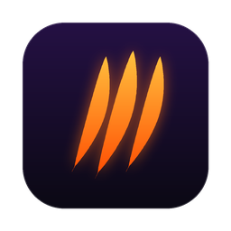

<p align="center">
  
</p>

<h1 align="center">Beast</h1>

<p align="center"><b>A personal interview assistant that sits on top of every app.</b><br/>
It reads the question on your screen or hears it in the meeting, and answers in seconds — code, system design, concepts, or debugging.</p>

<p align="center">
  <a href="docs/demos/index.html"><b>▶ Open the demo gallery</b></a> ·
  <a href="#quick-start">Quick start</a> ·
  <a href="#features">Features</a> ·
  <a href="#keyboard-shortcuts">Shortcuts</a> ·
  <a href="#stopping-beast">Stop / quit</a> ·
  <a href="#keys-and-privacy">Keys &amp; privacy</a>
</p>

---

Beast is a small, see-through bar that floats above everything — your browser, Zoom, your editor, even full-screen apps. Ask it something by typing, by speaking, by taking a screenshot, or just let it listen. Answers come back in the style of the round you are in.

Every demo below was **recorded from the real app**. The overlay is on the left; on the right a caption shows each step as it happens, with a preview of what is "on the screen". The screens are fixed test images, so the answers are real and nothing private (keys, your own desktop) is visible.

> **Tip:** the GIFs below are previews. For full-quality video, open the **[demo gallery](docs/demos/index.html)** (download the repo and open the file in your browser, or click any **▶ MP4** link).

## Contents

1. [Modes](#1-modes-design--code--concept--debug)
2. [Screenshot & send (💻 / ⌘↵)](#2-screenshot--send--or-)
3. [Area screenshot (⌘⇧S)](#3-area-screenshot-s)
4. [Follow-ups: more text, screenshots and files](#4-follow-ups-more-text-screenshots-and-files-in-the-same-conversation)
5. [History & Continue](#5-history-find-any-answer-and-continue-it)
6. [“Not useful” screens](#6-nothing-to-answer-not-useful)
7. [Debug mode](#7-debug-mode-claude-code-cli)
8. [Design, MCQ, any language](#8-design-rounds-multiple-choice-any-language)
9. [Solve screen (⌘⇧O)](#9-solve-screen-o-watches-and-answers-new-questions)
10. [Documents](#10-documents-résumé-notes-pdfs-logs)
11. [Listen & live transcript](#11-listen--live-transcript)
12. [Shortcuts panel, hide & quit](#12-shortcuts-panel-test-every-shortcut-hide-or-quit)

---

## Quick start

### What you need

| | Why |
|---|---|
| macOS 13+ (Apple Silicon or Intel) | The overlay, global shortcuts and system-audio capture are built for macOS |
| [Node.js 20+](https://nodejs.org) and [Rust](https://rustup.rs) | To build the app |
| A free [Groq API key](https://console.groq.com/keys) | Fast answers (Concept, Design, screenshots, Listen) |
| [Claude Code](https://claude.com/claude-code) installed and logged in (`claude` in Terminal) | Code and Debug answers use Claude Opus through your own login — no Anthropic key needed |

### Step by step

1. **Get the code**
   ```bash
   git clone https://github.com/rahulsjha/pluely.git beast
   cd beast
   npm install
   ```
2. **Add your keys (they stay on your computer)**
   ```bash
   cp .env.example .env.local
   open -e .env.local      # paste your Groq key after VITE_GROQ_API_KEY=
   ```
   `.env.local` is in `.gitignore`, so it can never be committed. Never put a key in any other file.
3. **Check Claude Code is logged in**
   ```bash
   claude -p "say hi"      # should print a reply; if not, run: claude  and log in
   ```
4. **Build and install the app**
   ```bash
   ./scripts/build-mac.sh  # builds, signs, installs /Applications/Beast.app and opens it
   ```
5. **Allow the two permissions** when macOS asks (or in *System Settings → Privacy & Security*):
   - **Screen & System Audio Recording** → turn on **Beast** (screenshots, Solve screen, Listen)
   - **Microphone** → turn on **Beast** (voice questions, your side of the transcript)

   Then quit and reopen Beast once (`osascript -e 'quit app "Beast"'; open -a Beast`).
6. **Try it:** open any coding problem in your browser and press **⌘↵**. The answer appears under the bar in a few seconds.

### Try it in the browser first (no build)

```bash
npm run dev                                   # app on http://localhost:1420
python3 scripts/webtest-bridge.py             # small local helper (screenshots + claude CLI)
open "http://localhost:1420/?webtest=1"
```
The browser version has every feature except the global shortcuts from other apps and system-audio capture (it uses your microphone instead).

---

## Features

### The bar at a glance

| Button | What it does |
|---|---|
| 🎧 **Listen** | Hears the meeting and answers questions it hears (⌘⇧M) |
| **Design · Code · Concept · Debug** | How Beast should answer. **Full / ⚡ Short** appears next to Concept |
| 🎤 **Mic** | Ask by voice (⌘⇧A) |
| 💻 **Screenshot** | Whole screen, sent at once with anything typed (⌘↵) |
| 📎 **Attach** | Images, PDFs, notes, logs, code |
| 💬 **Live transcript** | Who said what, with times; auto-answers questions |
| 🕘 **History** | Every past question and answer; **Continue** any of them |
| ⌨️ **Shortcuts & controls** | Test every shortcut, hide or quit Beast |
| ✨ **Dashboard** | Settings, shortcut editor, transparency |
| **Solve screen** | Next to the question bar: watches the screen and answers new questions (⌘⇧O) |

---

### 1. Modes: Design · Code · Concept · Debug


▶ [Watch the full video (MP4)](docs/demos/01-modes.mp4)

**What it does:** the mode decides the answer's shape and which model answers.

| Mode | Answer shape | Model | Typical time |
|---|---|---|---|
| **Concept — Full** | Definition · use case · diagram · example | Groq `gpt-oss-120b` | 1–3 s |
| **Concept — ⚡ Short** | Just the definition, at most 3 lines | Groq, low reasoning | under 1 s |
| **Design** | Requirements · estimates (with the maths) · API · data model · architecture diagram · bottlenecks · trade-offs | Groq `gpt-oss-120b` | 3–6 s |
| **Code** | Approach · dry run · complete runnable code · complexity | Claude Opus via your `claude` login | 13–25 s for typed questions (text streams early) |
| **Debug** | Root cause · evidence · fix · before vs after · how to verify | Claude Opus via your `claude` login | 5–30 s |

**How to use it**
1. Click a mode pill (Design, Code, Concept, Debug).
2. In Concept, click the **Full / ⚡ Short** chip to switch between a full answer and a 3-line definition.
3. Type a question and press **Enter** (Shift+Enter = new line).

**Good to know**
- Answers show markdown, tables, maths, copyable code and diagrams (broken diagrams are repaired automatically).
- Ask in Hindi (or any language) and the answer comes back in that language.

---

### 2. Screenshot & send: 💻 or ⌘↵


▶ [Watch the full video (MP4)](docs/demos/02-screenshot-send.mp4)

**What it does:** one click grabs the **whole screen** and sends it straight away, together with anything you typed. The answer opens with a thumbnail of the screenshot next to “Asked:”.

**How to use it**
1. Have the question on your screen (LeetCode, HackerRank, a doc, an error…).
2. Optional: type an instruction, e.g. *“Solve it in Java”*.
3. Click **💻** or press **⌘↵** — from any app, Beast doesn't need to be in front.

**Good to know**
- Screenshots answer in about **2–3 seconds** in Concept, Design and Code: a vision model reads the screen (question, options, code, errors) and the fast model answers in your mode's style. Debug uses Claude Opus for top quality.
- Beast hides itself from its own screenshots.
- Large/Retina screens are scaled to 1568 px first — still sharp enough to read small text, and faster.

---

### 3. Area screenshot: ⌘⇧S


▶ [Watch the full video (MP4)](docs/demos/03-area-screenshot.mp4)

**What it does:** pick just part of the screen. The crop **waits in the tray** (“Sending with next question”) so you can add a note or more screenshots before sending.

**How to use it**
1. Press **⌘⇧S**. The screen dims.
2. **Drag** a box around what matters. (Double-click = whole screen, **Esc** = cancel.)
3. Optional: click **✎** on the thumbnail and write a note just for this image, e.g. *“only the approach and the code”*.
4. Add more with **+ Screen** / **+ Area**, or press **⌘⇧S** again.
5. Press **Enter** (or **Send N**) — everything goes in one question.

---

### 4. Follow-ups: more text, screenshots and files in the same conversation


▶ [Watch the full video (MP4)](docs/demos/04-followups.mp4)

**What it does:** every answer has a **follow-up box** at the bottom. Anything you send there continues the **same conversation** — earlier questions stay visible above (Q1, Q2 …) with their screenshots and files, and the title shows *“Conversation · N questions”*.

**How to use it**
1. Ask anything (typed, 💻, ⌘↵…).
2. In the follow-up box at the bottom of the answer:
   - type your next question, and/or
   - **+ Screen** (whole screen) · **+ Area** (drag) · **📎** (images or files).
   Pending items show as small chips *“Will be added to this conversation”* — remove any with ✕.
3. Press **Send** (or Enter in the box).
4. Earlier answers are folded; click **Show full answer** to expand one.
5. **+ New** starts a fresh conversation. **✕** closes the answer and ends the conversation (you can reopen it from History).

**Good to know**
- Clicking 💻 or pressing ⌘↵ while an answer is open also adds to the same conversation.
- Follow-ups remember the whole thread even when earlier answers came from a different model.

---

### 5. History: find any answer and continue it


▶ [Watch the full video (MP4)](docs/demos/05-history-continue.mp4)

**What it does:** every question and answer (typed, voice, screenshot, Listen) is saved **on this computer**, grouped by day, with the mode and how long it took.

**How to use it**
1. Click **🕘 History**.
2. Search, or filter by mode. Click a row to read the full answer; copy or delete it.
3. Press **Continue** on any row — the whole conversation reopens with its screenshots, and the cursor is in the follow-up box.
4. Type or attach more and press **Send**.

The **Transcript sessions** tab keeps past Live-transcript sessions with their lines and answers.

---

### 6. Nothing to answer? “Not useful”


▶ [Watch the full video (MP4)](docs/demos/06-not-useful.mp4)

**What it does:** if a screenshot shows no question, code or error (a desktop, a chat app, a blank page), Beast replies with one line — *“⚠️ Not useful — … attach one that shows the question, code or error.”* — instead of guessing. It works the same in every mode.

---

### 7. Debug mode (Claude Code CLI)


▶ [Watch the full video (MP4)](docs/demos/07-debug.mp4)

**What it does:** Debug answers come from **Claude Opus through your logged-in Claude Code CLI** for the highest quality. Every answer has the same shape: **Root cause → Evidence** (the exact line) **→ Fix → Before vs After → How to verify**.

**How to use it**
1. Click **Debug**.
2. Give it evidence any way you like: **⌘↵** (whole screen), **⌘⇧S** (an area), **📎** a log or screenshot, drag a file onto the bar, or paste a long stack trace into the bar (it becomes an attachment).
3. Press **Enter** — with no message it sends *“Debug this using the attached evidence.”*

**Good to know:** follow-ups continue the same Claude session, so it remembers what it already saw.

---

### 8. Design rounds, multiple choice, any language


▶ [Watch the full video (MP4)](docs/demos/08-design-mcq-language.mp4)

- **Design:** a prompt like *“Design a URL shortener”* gets a full design answer — requirements, scale estimates with the maths, API, data model, an architecture diagram, bottlenecks and trade-offs.
- **Multiple choice:** the correct option first, then one line on why.
- **Any language:** a question in Hindi gets an answer in Hindi (same for other languages).

---

### 9. Solve screen: ⌘⇧O watches and answers new questions


▶ [Watch the full video (MP4)](docs/demos/09-solve-screen.mp4)

**What it does:** while it's on, Beast checks the screen every few seconds. When a **new** question appears it reads the full text (examples, constraints, options) and answers in the matching mode: coding → Code, design → Design, concept/MCQ → Concept.

**How to use it**
1. Press **⌘⇧O** or click **Solve screen** (next to the question bar).
2. Scroll through an assessment as usual — each new question is answered once and lands in the **answer queue**.
3. Press **⌘⇧O** again to stop.

**Good to know:** the same question still on screen is never answered twice; pages with no question are ignored. The small thumbnail by the button shows exactly what was read.

---

### 10. Documents: résumé, notes, PDFs, logs


▶ [Watch the full video (MP4)](docs/demos/10-documents.mp4)

**What it does:** attach files and Beast reads them and answers using them — great for *“Tell me about yourself”* from your own résumé, or a question about your notes.

**How to use it**
1. Click **📎** (or drag files onto the bar). Supported: images, **PDF**, `.md`, `.txt`, `.csv`, `.json`, logs and code files.
2. Each file shows in the tray with how many characters were read; add a ✎ note to any of them.
3. Ask your question and press **Enter**.

---

### 11. Listen + live transcript


▶ [Watch the full video (MP4)](docs/demos/11-listen.mp4)

**What it does:** Listen hears the meeting (the computer's audio — Zoom, Meet, Teams, any app) and your microphone, and answers questions as soon as they are asked.

> **About this recording:** it uses the browser version, so the questions are played from the laptop's speaker into its own microphone (a synthetic voice, mic input turned up for the recording). That loop is much quieter than a real person talking, so in the browser a question played this way is sometimes missed. The desktop app reads the meeting's audio directly and doesn't have this problem.

**How to use it**
1. Click **🎧** or press **⌘⇧M**. A green status row shows it is listening (all modes and buttons stay usable).
2. When a question is heard, the answer opens on its own — usually a second or two after the speaker stops.
3. Click **💬 Live transcript** to see who said what (**You** in blue, **Interviewer** in amber), with times.
   - **Auto: Interviewer / You** — choose whose questions are answered automatically.
   - Any line has an **Answer** button to answer it on demand.
4. Click **🎧** (or ⌘⇧M) again to stop.

**Good to know**
- Small talk and noise (“thank you”, “yes yes”) are ignored; only questions and tasks are answered.
- Several questions in one breath are split into separate answers in the **answer queue** (waiting → answering → answered), one at a time, each in the mode it was asked in. A new question never cuts off the answer that is streaming.
- Desktop app: system audio is captured directly — no BlackHole, no tab sharing.

---

### 12. Shortcuts panel: test every shortcut, hide or quit


▶ [Watch the full video (MP4)](docs/demos/12-shortcuts-stop.mp4)

**What it does:** the **⌨️** button lists every shortcut with its keys and what it does.

**How to use it**
1. Click **⌨️**.
2. Press any shortcut (from any app): its row gets a green **✓** and the time, and the counter goes up (e.g. *9/9 worked*). Or press **Try**.
3. **Stop Beast:** **Hide (⌘\\)** keeps it running; **Quit Beast** asks *Yes / Cancel* first.
4. Click any Terminal command to copy it.

---

## Keyboard shortcuts

All of these work from **any app** in the desktop version. Change them in Dashboard (⌘⇧D) → Shortcuts.

| Keys | What it does |
|---|---|
| **⌘ ↵** | Screenshot the whole screen and send it now (with anything typed) |
| **⌘ ⇧ S** | Area screenshot — drag to pick; waits in the tray until Enter |
| **⌘ ⇧ O** | Solve screen on / off |
| **⌘ ⇧ M** | Listen on / off |
| **⌘ ⇧ A** | Ask by voice on / off |
| **⌘ ⇧ I** | Bring Beast forward with the cursor in the question bar |
| **⌘ \\** | Hide / show Beast |
| **⌘ ⇧ D** | Dashboard (settings, shortcut editor) |
| **⌘ + arrows** | Move the bar (hold to keep moving) |
| **Enter** / **Shift+Enter** | Send / new line |
| **⌘ K** | Conversation mode in the answer (whole thread, newest first) |
| **Esc** | Close the answer, or cancel an area screenshot |

## Stopping Beast

Beast has no Dock icon, so **⌘Q usually won't reach it**. Use one of these:

| How | Command / action |
|---|---|
| Inside the app | ⌨️ → **Quit Beast** → *Yes, quit Beast* (or Dashboard → menu → Quit) |
| Hide without quitting | **⌘ \\** (press again to bring it back) |
| Terminal — normal quit | `osascript -e 'quit app "Beast"'` |
| Terminal — not responding | `pkill -x Beast` |
| Terminal — force (last resort) | `pkill -9 -x Beast` |
| Is it running? | `pgrep -lx Beast` |
| Start again | `open -a Beast` |
| Don't start at login | System Settings → General → Login Items → remove Beast |

## Keys and privacy

- **Keys live only in `.env.local`** on your computer. It is listed in `.gitignore`; `.env.example` has empty placeholders only. Never paste a key into source files, issues or screenshots.
- **Claude answers use your own Claude Code login** (`claude` CLI). Beast never reads or stores Claude tokens.
- History, transcripts and conversations are stored **on this computer only**.
- Before pushing, a quick check that no key slipped in:
  ```bash
  git grep -nE "gsk_[A-Za-z0-9]{10,}|sk-ant-|sk-[A-Za-z0-9]{24,}" -- . ':!*.lock' || echo "clean"
  ```

## Troubleshooting

| Problem | Fix |
|---|---|
| “Screen Recording is off for Beast” | System Settings → Privacy & Security → Screen & System Audio Recording → turn on **Beast**, then quit and reopen it |
| Beast doesn't show over a full-screen app | Press ⌘\\ twice; make sure *Always on top* is on in Dashboard → Settings |
| Listen hears nothing | Check the Microphone and Screen & System Audio Recording permissions; then ⌘⇧M off and on |
| Code/Debug answers fail | Run `claude -p "hi"` in Terminal — if it asks you to log in, run `claude` and log in |
| Concept/Design answers fail | Check `VITE_GROQ_API_KEY` in `.env.local`, then rebuild |

## Testing

Browser test scripts (they drive the real UI through Chrome's debugging port) live in `scripts/demo/`:

| Script | Checks |
|---|---|
| `shortcut-suite.mjs` | Every shortcut on the real screen |
| `screenshot-matrix.mjs` | 26 screenshot cases across modes and screens ([cases](docs/screenshot-test-cases.md)) |
| `continue-conversation-test.mjs` | 💻 again, follow-up with screen + file, close, History → Continue, New (7 checks) |
| `shortcuts-panel-test.mjs` | ⌨️ panel: every row ticks, Try, Quit confirm (13 checks) |
| `feature-demos.mjs` + `build-gallery.mjs` | Records the 12 demo videos and builds the [gallery](docs/demos/index.html) |

More detail: [features guide](docs/features.md) · [test workflow](docs/test-workflow.md) · [model routing](docs/model-routing.md).

## Credits & licence

Beast is a fork of [Pluely](https://github.com/iamsrikanthnani/pluely) by Srikanth Nani, released under the **GNU GPL v3** (see [LICENSE](LICENSE)).
