<a href="#-see-it-in-action">
  <picture>
    <source media="(prefers-color-scheme: dark)" srcset="docs/assets/cover-dark.jpg" />
    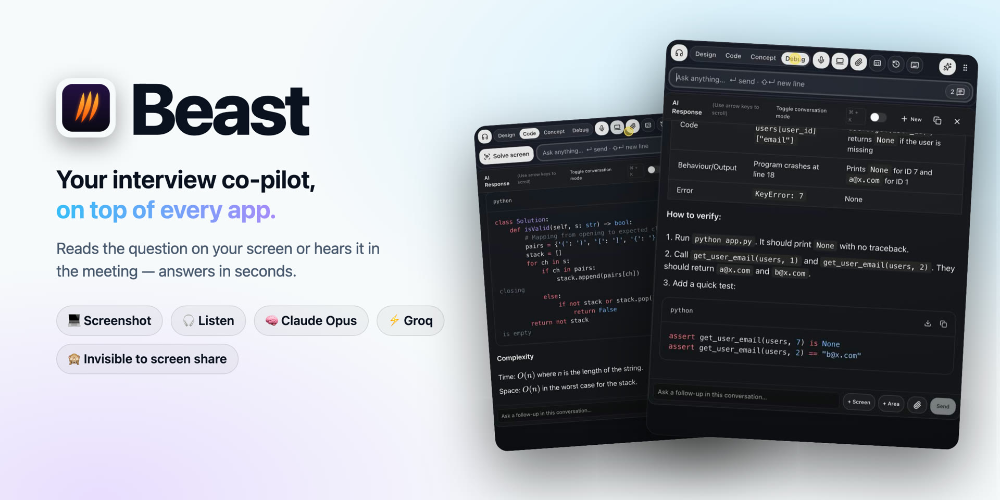
  </picture>
</a>

<h3 align="center">An always-on-top AI assistant that reads the question on your screen<br/>or hears it in the meeting — and answers in seconds.</h3>

<p align="center"><b>Free and open source</b> — an alternative to paid interview copilots.<br/>Bring your own free Groq key; Code and Debug run on <b>Claude Opus</b> through the Claude Code login you already have.</p>

<p align="center">
  <a href="#-quick-start"></a>
  <a href="https://v2.tauri.app"></a>
  <a href="https://react.dev"></a>
  <a href="https://www.rust-lang.org"></a>
  <br/>
  <a href="https://claude.com/claude-code"></a>
  <a href="https://groq.com"></a>
  <a href="LICENSE"></a>
  <a href="https://github.com/rahulsjha/BeastAI/stargazers"></a>
</p>

<p align="center">
  <a href="#-see-it-in-action"><b>Demo</b></a> •
  <a href="#-features"><b>Features</b></a> •
  <a href="#-quick-start"><b>Quick start</b></a> •
  <a href="#%EF%B8%8F-keyboard-shortcuts"><b>Shortcuts</b></a> •
  <a href="#-how-it-works"><b>How it works</b></a> •
  <a href="#-keys--privacy"><b>Privacy</b></a> •
  <a href="docs/demos/index.html"><b>Demo gallery</b></a>
</p>

<br/>

## 🎬 See it in action

One shortcut — **⌘↵** — grabs the screen, reads the question, and answers in the style of your round:

<!-- video:02-screenshot-send -->
<p align="center"><a href="docs/demos/02-screenshot-send.mp4">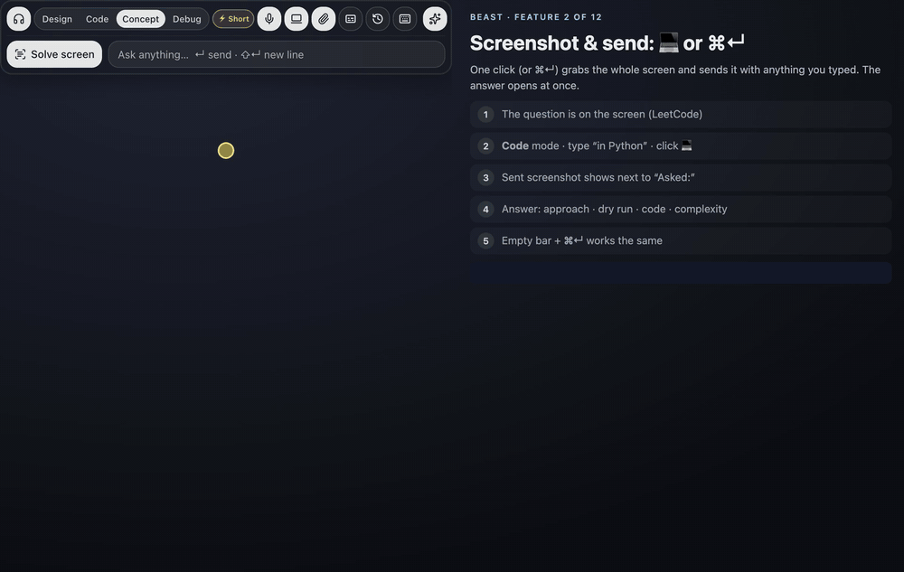</a></p>
<!-- /video -->

<sub>Every clip in this README is recorded from the real app. The overlay is on the left; the caption panel on the right shows each step as it happens and the “screen” Beast is reading. The screens are fixed test images, so the answers are real and nothing private is visible.</sub>

<br/>

## ✨ Why Beast

<table>
<tr>
<td width="33%" valign="top">

### 🙈 Invisible
A see-through bar that floats over every app — browser, Zoom, your IDE, even full-screen — and **doesn't show up in screen share**.

</td>
<td width="33%" valign="top">

### ⚡ Fast
Screenshots answered in **~2–3 s**. Short concept answers in **under a second** on Groq. Text streams in as it's written.

</td>
<td width="33%" valign="top">

### 🧠 Smart where it matters
Code and Debug use **Claude Opus** through your own Claude Code login — no API key, top quality.

</td>
</tr>
<tr>
<td valign="top">

### 💬 Hands-free
**Auto** is on as soon as Beast opens: it hears you and the interviewer, spots every question and answers it in your mode — no buttons to press.

</td>
<td valign="top">

### 🧵 Real conversations
Keep going with more text, screenshots and files in the same thread. Reopen anything from **History**.

</td>
<td valign="top">

### 🔒 Private
Keys live only in `.env.local`. History stays on your machine. Nothing is uploaded except the question itself.

</td>
</tr>
</table>

### Beast vs. paid interview copilots

| | **Beast** | Typical paid copilot |
|:--|:--:|:--:|
| Price | **Free** — your own Groq key + Claude subscription | Monthly subscription |
| Source code | **Open (GPL-3.0)** — read every line | Closed |
| Models | **Claude Opus** for code & debug, **Groq** for sub-second answers | Vendor's choice |
| Your history | **On your Mac only** | Vendor's servers |
| Solve-screen watcher, follow-ups with screenshots, shortcut tester | ✅ | Varies |

<br/>

## 🧩 Features

Click any card to jump to its video and step-by-step guide.

<table>
<tr>
<td align="center" width="33%"><a href="#1-modes">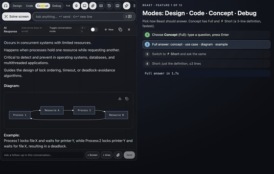<br/><b>1 · Modes</b></a><br/><sub>Design · Code · Concept · Debug</sub></td>
<td align="center" width="33%"><a href="#2-screenshot--send">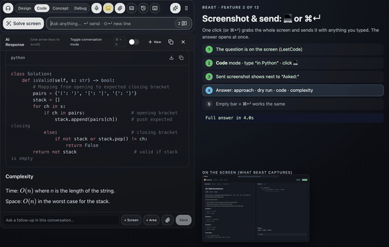<br/><b>2 · Screenshot &amp; send</b></a><br/><sub>💻 or ⌘↵ — whole screen, answered at once</sub></td>
<td align="center" width="33%"><a href="#3-area-screenshot">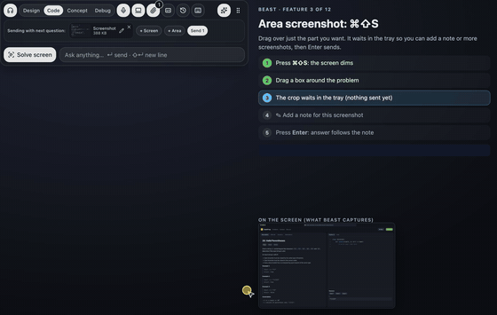<br/><b>3 · Area screenshot</b></a><br/><sub>⌘⇧S — drag, add a note, send</sub></td>
</tr>
<tr>
<td align="center"><a href="#4-follow-ups">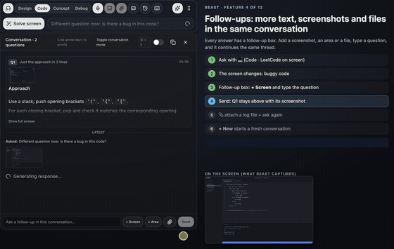<br/><b>4 · Follow-ups</b></a><br/><sub>More text, screens &amp; files in one thread</sub></td>
<td align="center"><a href="#5-history--continue">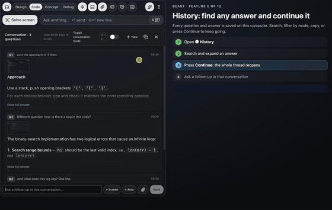<br/><b>5 · History &amp; Continue</b></a><br/><sub>Find any answer, pick up where you left off</sub></td>
<td align="center"><a href="#6-not-useful">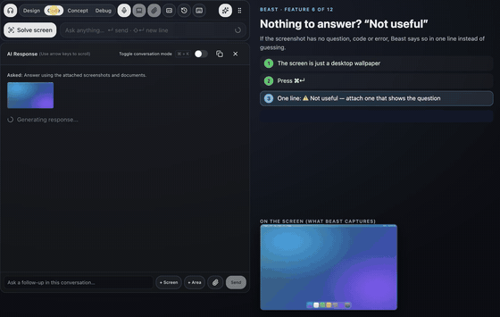<br/><b>6 · “Not useful”</b></a><br/><sub>No question on screen? No guessing.</sub></td>
</tr>
<tr>
<td align="center"><a href="#7-debug">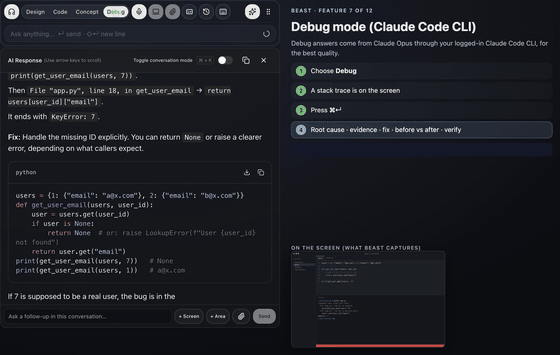<br/><b>7 · Debug</b></a><br/><sub>Root cause → fix → before vs after</sub></td>
<td align="center"><a href="#8-design-mcq-any-language">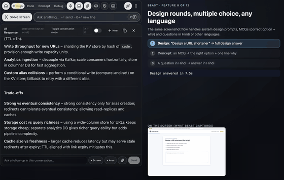<br/><b>8 · Design, MCQ, any language</b></a><br/><sub>Full system design · right option · always answered in English</sub></td>
<td align="center"><a href="#9-solve-screen">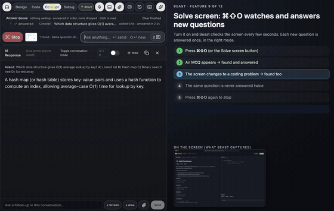<br/><b>9 · Solve screen</b></a><br/><sub>⌘⇧O — watches and answers new questions</sub></td>
</tr>
<tr>
<td align="center"><a href="#10-documents">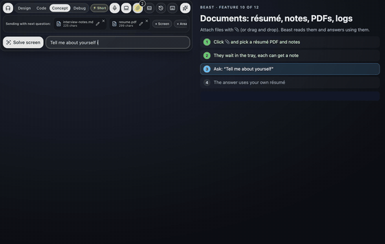<br/><b>10 · Documents</b></a><br/><sub>Résumé, notes, PDFs, logs</sub></td>
<td align="center"><a href="#11-listen--live-transcript">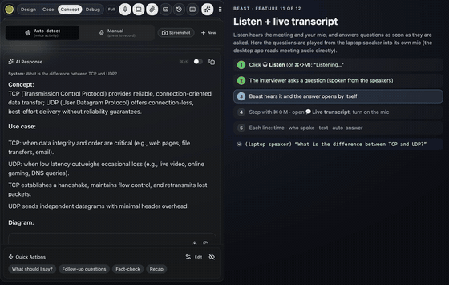<br/><b>11 · Auto: hears &amp; answers</b></a><br/><sub>Always on — you + interviewer, answered live</sub></td>
<td align="center"><a href="#12-shortcuts-panel">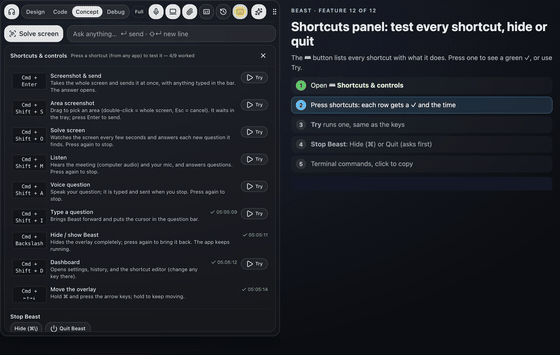<br/><b>12 · Shortcuts panel</b></a><br/><sub>Test every shortcut · hide · quit</sub></td>
</tr>
</table>

### The bar at a glance

| Button | What it does | Keys |
|:--|:--|:--:|
| ● **Auto** | On at start: hears you **and** the interviewer, detects every question and answers it in the current mode. Click to pause / resume | ⌘⇧M |
| **Design · Code · Concept · Debug** | How Beast should answer. **Full / ⚡ Short** appears next to Concept | — |
| 💻 **Screenshot** | Captures the screen, then: **Send now · + Another screenshot · + Area · ✎ Add text**. (⌘↵ captures and sends at once) | ⌘↵ |
| 📎 **Attach** | Images, PDFs, notes, logs, code | — |
| 💬 **Live transcript** | Who said what, with times; auto-answers questions | — |
| 🕘 **History** | Every past question and answer; **Continue** any of them | — |
| ⌨️ **Shortcuts & controls** | Test every shortcut, hide or quit Beast | — |
| 👁 **Hide / quit** | Hide now, hide for 1 / 5 / 15 min, or quit | ⌘\\ |
| ✨ **Dashboard** | Settings, shortcut editor, transparency | ⌘⇧D |
| **Solve screen** | Watches the screen and answers each new question | ⌘⇧O |

---

<a id="1-modes"></a>
### 1 · Modes — Design · Code · Concept · Debug

> Pick how Beast answers. The mode decides the answer's shape **and** which model writes it.

<!-- video:01-modes -->
<p align="center"><a href="docs/demos/01-modes.mp4">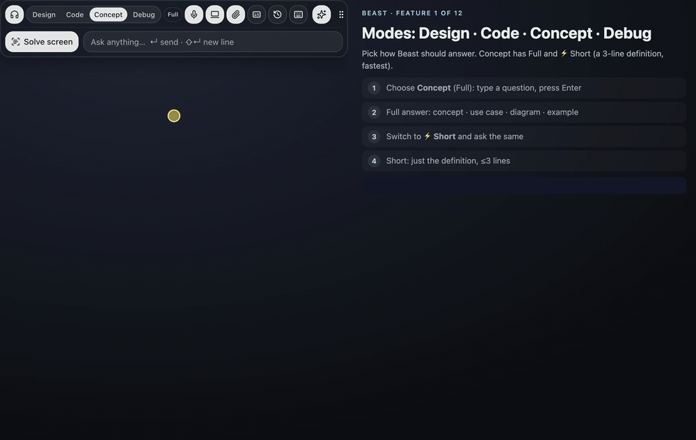</a></p>
<!-- /video -->

| Mode | Answer shape | Model | Typical time |
|:--|:--|:--|:--|
| **Concept · Full** | Definition · use case · diagram · example | Groq `gpt-oss-120b` | 1–3 s |
| **Concept · ⚡ Short** | Just the definition, at most 3 lines | Groq, low reasoning | < 1 s |
| **Design** | Requirements · estimates (with the maths) · API · data model · architecture diagram · bottlenecks · trade-offs | Groq `gpt-oss-120b` | 3–6 s |
| **Code** | Approach · dry run · complete runnable code · complexity | Claude Opus (your `claude` login) | 13–25 s, streams early |
| **Debug** | Root cause · evidence · fix · before vs after · how to verify | Claude Opus (your `claude` login) | 5–30 s |

Every answer has the **same layout in its mode**: a one-line **Answer:** first, then that mode's sections in a fixed order (so you always know where to look).

**How to use it**
1. Click a mode pill — **Design**, **Code**, **Concept** or **Debug**.
2. In Concept, click the **Full / ⚡ Short** chip to switch between a full answer and a 3-line definition.
3. Type a question and press **Enter** (**Shift+Enter** = new line).

<details><summary><b>Good to know</b></summary>

- Answers render markdown, tables, maths, copyable code and diagrams. Broken diagrams are repaired automatically.
- Answers are always in **English** (speech is transcribed as English; a question on screen in another language is understood and answered in English). Ask explicitly if you want another language.
</details>

<a id="2-screenshot--send"></a>
### 2 · Screenshot & send — 💻 or ⌘↵

> **💻** grabs the whole screen and asks what next: **Send now**, **+ Another screenshot**, **+ Area** or **✎ Add text**. **⌘↵** skips the question and sends at once. The answer opens with a thumbnail of the screenshot next to “Asked:”.

<!-- video:02-screenshot-send -->
<p align="center"><a href="docs/demos/02-screenshot-send.mp4"></a></p>
<!-- /video -->

**How to use it**
1. Have the question on your screen — LeetCode, HackerRank, a doc, an error…
2. *Optional:* type an instruction, e.g. **“Solve it in Java”**.
3. Click **💻** — a card shows *“📸 1 screenshot ready”* with **Send now · + Another screenshot · + Area · ✎ Add text · Clear**. Add as many as you need, type a note, then **Send now**.
4. In a hurry? **⌘↵** captures and sends in one go — from any app; Beast doesn't need to be in front.

<details><summary><b>Good to know</b></summary>

- Screenshots answer in about **2–3 s** in Concept, Design and Code: a vision model reads the screen (question, options, code, errors) and the fast model answers in your mode's style. Debug uses Claude Opus for top quality.
- Beast hides itself from its own screenshots.
- Large/Retina screens are scaled to 1568 px first — still sharp enough for small text, and faster.
</details>

<a id="3-area-screenshot"></a>
### 3 · Area screenshot — ⌘⇧S

> Pick just part of the screen. The crop **waits in the tray** so you can add a note or more screenshots before sending.

<!-- video:03-area-screenshot -->
<p align="center"><a href="docs/demos/03-area-screenshot.mp4">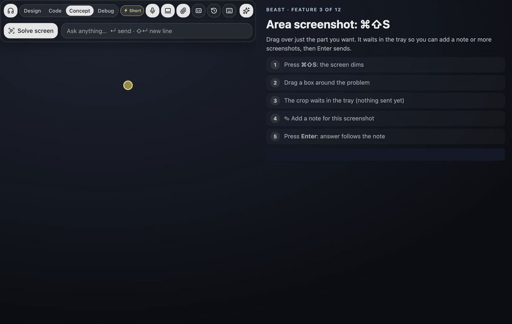</a></p>
<!-- /video -->

**How to use it**
1. Press **⌘⇧S** — the screen dims.
2. **Drag** a box around what matters. *(Double-click = whole screen, **Esc** = cancel.)*
3. *Optional:* click **✎** on the thumbnail and write a note just for this image, e.g. **“only the approach and the code”**.
4. Add more with **+ Screen** / **+ Area**, or press **⌘⇧S** again.
5. Press **Enter** (or **Send N**) — everything goes in one question.

<a id="4-follow-ups"></a>
### 4 · Follow-ups — more text, screenshots and files in the same conversation

> Every answer has a **follow-up box**. Anything you send there continues the **same conversation** — earlier questions stay visible above (Q1, Q2 …) with their screenshots and files.

<!-- video:04-followups -->
<p align="center"><a href="docs/demos/04-followups.mp4">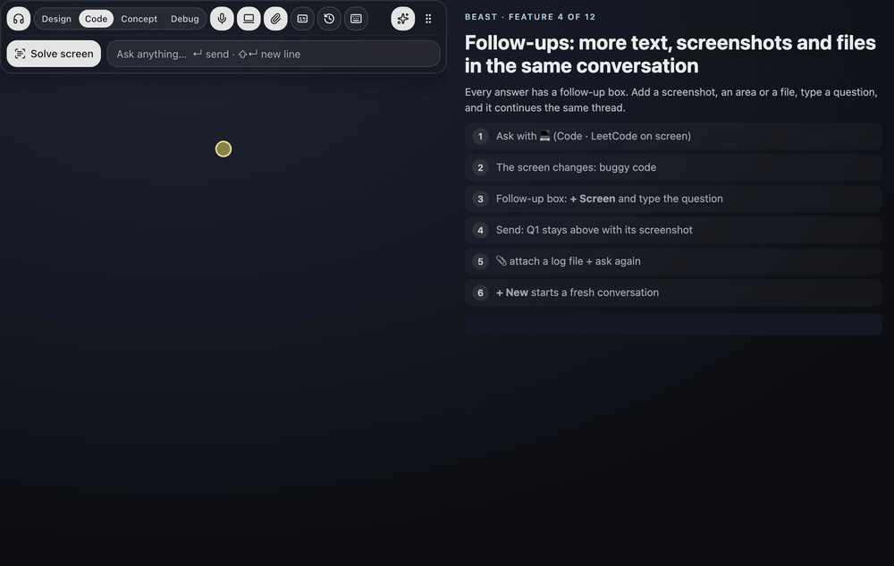</a></p>
<!-- /video -->

**How to use it**
1. Ask anything — typed, 💻, ⌘↵…
2. In the follow-up box at the bottom of the answer, type your next question and/or add **+ Screen** (whole screen), **+ Area** (drag) or **📎** (images, files). Pending items show as chips — *“Will be added to this conversation”* — remove any with ✕.
3. Press **Send** (or Enter in the box). The title becomes **“Conversation · N questions”**.
4. Earlier answers are folded — click **Show full answer** to expand one.
5. **+ New** starts fresh. **✕** closes the answer and ends the conversation (reopen it from History).

<details><summary><b>Good to know</b></summary>

- Keep adding as many screenshots as you need before sending (up to 10 per message): **+ Screen** in the box, or **⌘⇧↵** from any app while you scroll.
- Clicking 💻 or pressing ⌘↵ while an answer is open also adds to the same conversation.
- Follow-ups remember the whole thread, even when earlier answers came from a different model.
- **🎤 in the follow-up box**: speak instead of typing — it's added to this conversation (Auto pauses meanwhile).
- **Resize**: drag the bar at the bottom of the answer panel (or double-click it / press ⤢ for full height). **Move**: drag the panel's title.
</details>

<a id="5-history--continue"></a>
### 5 · History & Continue

> Every question and answer — typed, voice, screenshot, Listen — is saved **on this computer**, grouped by day, with the mode and how long it took.

<!-- video:05-history-continue -->
<p align="center"><a href="docs/demos/05-history-continue.mp4">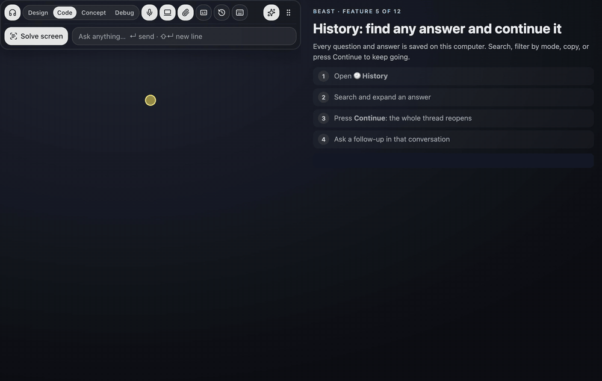</a></p>
<!-- /video -->

**How to use it**
1. Click **🕘 History** — one row per **conversation** (“3 Q” = three questions), newest first.
2. Search, or filter by mode. Click a row to read **every** question and answer in it (scrolls both ways).
3. Add to any past conversation straight from its row:
   - **Continue** — reopens it with the cursor in the follow-up box;
   - **📸** — reopens it with a screenshot of the screen waiting to send;
   - **🎤** — reopens it and starts listening: speak your follow-up.
4. Type / attach more and press **Send**.
5. **Delete**: 🗑 on a row (asks first), **Older than 7 days**, or **Clear all** (both ask first).

The **Transcript sessions** tab keeps past Live-transcript sessions with their lines and answers.

<a id="6-not-useful"></a>
### 6 · “Not useful” — no guessing

> If a screenshot shows no question, code or error (a desktop, a chat app, a blank page), Beast says so in one line instead of making something up. Same in every mode.

<!-- video:06-not-useful -->
<p align="center"><a href="docs/demos/06-not-useful.mp4">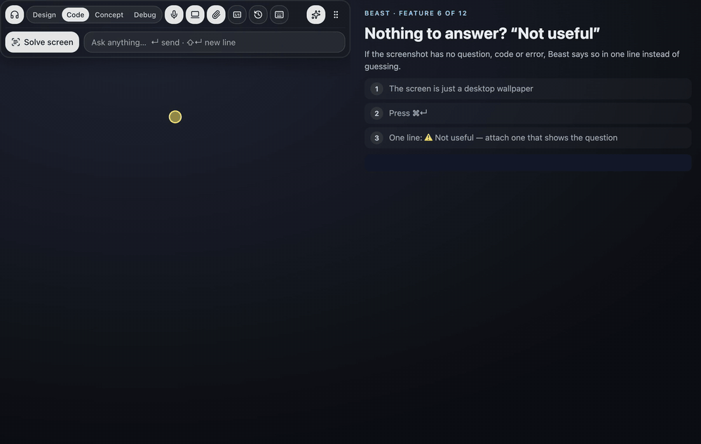</a></p>
<!-- /video -->

<a id="7-debug"></a>
### 7 · Debug — Claude Opus via Claude Code

> Every Debug answer has the same shape: **Root cause → Evidence** (the exact line) **→ Fix → Before vs After → How to verify**.

<!-- video:07-debug -->
<p align="center"><a href="docs/demos/07-debug.mp4">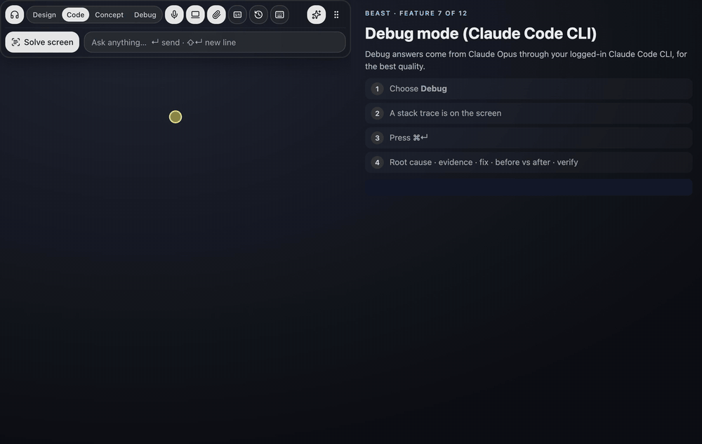</a></p>
<!-- /video -->

**How to use it**
1. Click **Debug**.
2. Give it evidence any way you like: **⌘↵** (whole screen), **⌘⇧S** (an area), **📎** a log or screenshot, drag a file onto the bar, or paste a long stack trace (it becomes an attachment).
3. Press **Enter** — with no message it sends *“Debug this using the attached evidence.”*

Follow-ups continue the same Claude session, so it remembers what it already saw.

<a id="8-design-mcq-any-language"></a>
### 8 · Design rounds, multiple choice, any language

<!-- video:08-design-mcq-language -->
<p align="center"><a href="docs/demos/08-design-mcq-language.mp4">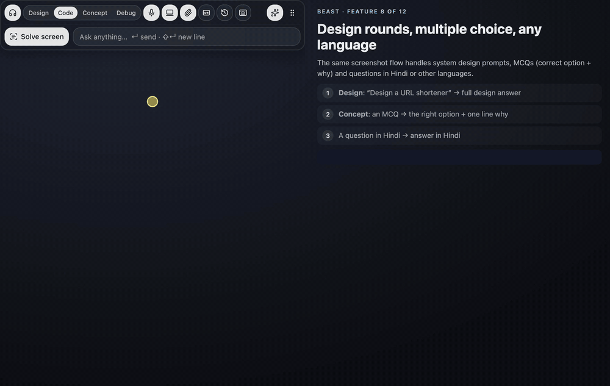</a></p>
<!-- /video -->

| | What you get |
|:--|:--|
| **System design** | *“Design a URL shortener”* → requirements, scale estimates with the maths, API, data model, architecture diagram, bottlenecks, trade-offs |
| **Multiple choice** | The correct option first, then one line on why |
| **Any language in, English out** | A question in Hindi (or any language) is understood and answered in English |

<a id="9-solve-screen"></a>
### 9 · Solve screen — ⌘⇧O

> While it's on, Beast checks the screen every few seconds. When a **new** question appears it reads the full text — examples, constraints, options — and answers in the matching mode.

<!-- video:09-solve-screen -->
<p align="center"><a href="docs/demos/09-solve-screen.mp4">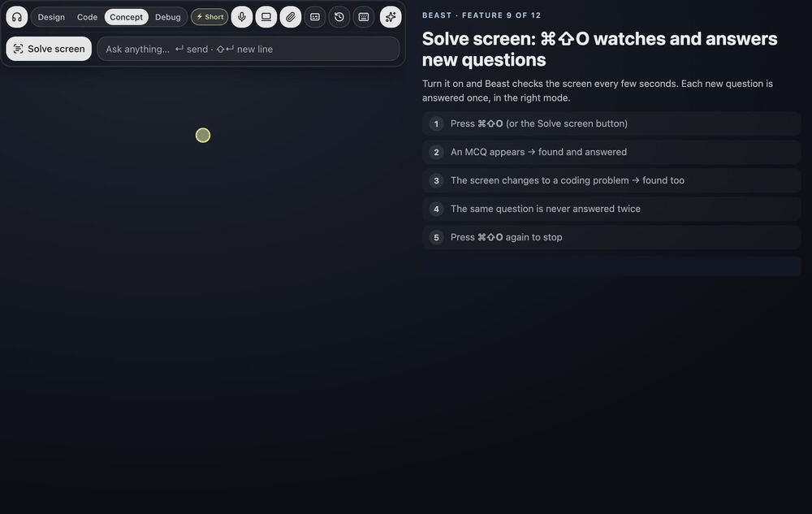</a></p>
<!-- /video -->

**How to use it**
1. Press **⌘⇧O** or click **Solve screen** (next to the question bar).
2. Scroll through an assessment as usual — each new question is answered once and lands in the **answer queue**.
3. Press **⌘⇧O** again to stop.

<details><summary><b>Good to know</b></summary>

- Coding → **Code**, design → **Design**, concept/MCQ → **Concept**, debugging → **Debug**.
- The same question still on screen is never answered twice; pages with no question are ignored.
- The small thumbnail by the button shows exactly what was read.
</details>

<a id="10-documents"></a>
### 10 · Documents — résumé, notes, PDFs, logs

> Attach files and Beast answers using them — perfect for *“Tell me about yourself”* from your own résumé.

<!-- video:10-documents -->
<p align="center"><a href="docs/demos/10-documents.mp4">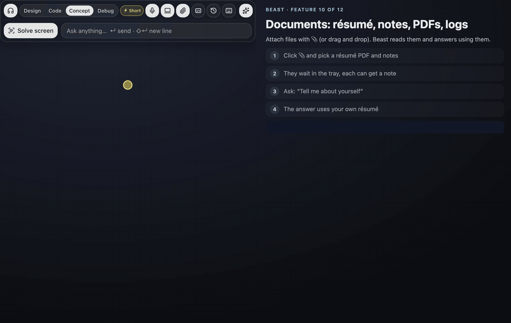</a></p>
<!-- /video -->

**How to use it**
1. Click **📎** (or drag files onto the bar). Supported: images, **PDF**, `.md`, `.txt`, `.csv`, `.json`, logs and code.
2. Each file shows in the tray with how many characters were read; add a **✎** note to any of them.
3. Ask your question and press **Enter**.

<a id="11-listen--live-transcript"></a>
### 11 · Auto — hears you and the interviewer, answers every question

> One switch, **on as soon as Beast opens**. It hears the meeting (Zoom, Meet, Teams — any app) and your microphone, detects each question, and answers it in the current mode — the answers build up as a chat thread.

<!-- video:11-listen -->
<p align="center"><a href="docs/demos/11-listen.mp4">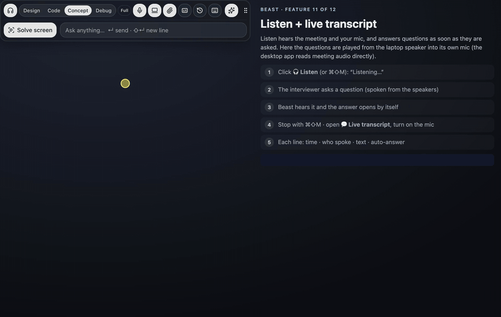</a></p>
<!-- /video -->

**How to use it**
1. Nothing to press: the **● Auto** pill at the top left is green and a status line shows what was last heard.
2. When a question is heard, the answer opens on its own and joins the conversation thread (earlier Q&As stay above) — Concept and Design answer in a second or two; **Code and Debug always use Claude Opus 5.5 at high effort** (text starts streaming after ~6–12 s and keeps arriving — scroll up any time, it won't pull you back).
3. Click **💬 Live transcript** to see who said what — **You** in blue, **Interviewer** in amber — with times.
   - **Auto: Interviewer / You** — choose whose questions are answered automatically.
   - Every line has an **Answer** button to answer it on demand.
4. Click **● Auto** (or press ⌘⇧M / ⌘⇧A) to pause; again to resume.

<details><summary><b>Good to know</b></summary>

- Small talk and noise (“thank you”, “yes yes”) are ignored; only questions and tasks are answered.
- Misheard technical words are fixed before answering — the answer starts with **“Heard as: …”** when a word was corrected (e.g. “boon filter” → Bloom filter). If a line can't be understood at all you get **“🎧 Couldn't make out the question — heard: “…”. Please repeat it.”** instead of a wrong answer.
- Stress-tested with 55 questions from 28 voices (US/UK/AU/IE/IN accents, non-English voices reading English, robotic voices, 130–220 wpm) played through a laptop speaker: ~47–50 answered, natural voices 27/31, 0 of 15 statements answered by mistake. Misses were robotic/whispering voices and heavy accents above ~200 wpm (`scripts/demo/auto-stress-test.mjs`).
- Several questions in one breath become separate jobs in the **answer queue** (waiting → answering → answered), answered one at a time in the mode each was asked in. A new question never cuts off the answer that is streaming.
- The desktop app captures system audio directly — no BlackHole, no tab sharing.
- *About this recording:* it uses the browser version, so the questions are played from the laptop speaker into its own mic. That loop is much quieter than a real voice, so a question played this way is sometimes missed in the browser. The desktop app reads the meeting's audio directly.
</details>

<a id="12-shortcuts-panel"></a>
### 12 · Shortcuts panel — test every shortcut, hide or quit

> The **⌨️** button lists every shortcut with its keys and what it does — and proves each one works.

<!-- video:12-shortcuts-stop -->
<p align="center"><a href="docs/demos/12-shortcuts-stop.mp4">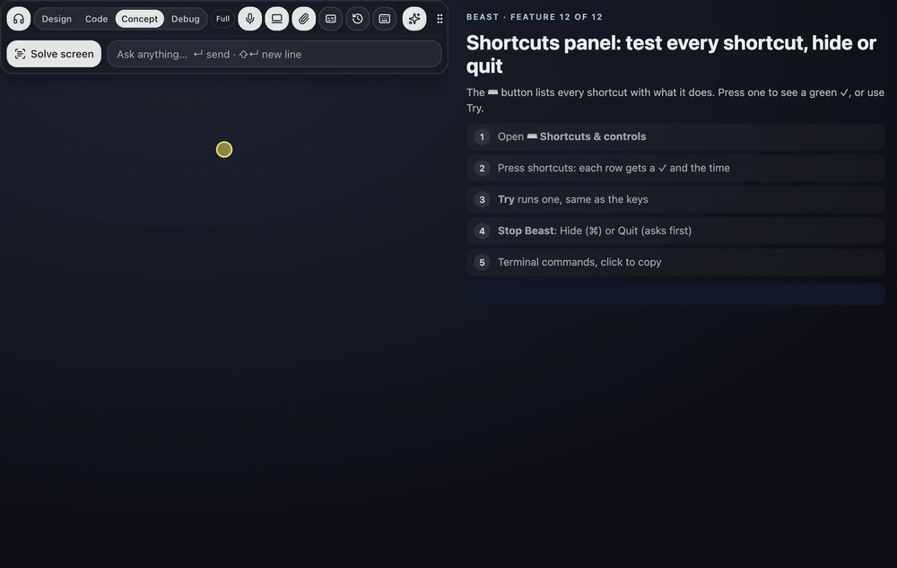</a></p>
<!-- /video -->

**How to use it**
1. Click **⌨️**.
2. Press any shortcut, from any app: its row gets a green **✓** with the time and the counter goes up (e.g. *9/9 worked*). Or press **Try**.
3. **Hide (⌘\\)** keeps Beast running; **Quit Beast** asks *Yes / Cancel* first.
4. Click any Terminal command to copy it.

---

## 🚀 Quick start

### Requirements

| | Why |
|:--|:--|
| **macOS 13+** (Apple Silicon or Intel) | The overlay, global shortcuts and system-audio capture are built for macOS |
| **[Node.js 20+](https://nodejs.org)** and **[Rust](https://rustup.rs)** | To build the app |
| A free **[Groq API key](https://console.groq.com/keys)** | Fast answers — Concept, Design, screenshots, Listen |
| **[Claude Code](https://claude.com/claude-code)**, logged in | Code and Debug use Claude Opus through your own login — no Anthropic key |

### Install

```bash
# 1. Get the code
git clone https://github.com/rahulsjha/BeastAI.git beast && cd beast
npm install

# 2. Add your Groq key — .env.local is git-ignored and never committed
cp .env.example .env.local
open -e .env.local            # paste your key after VITE_GROQ_API_KEY=

# 3. Check Claude Code is logged in
claude -p "say hi"            # prints a reply? good. If not, run `claude` and log in

# 4. Build, sign and install /Applications/Beast.app (opens when done)
./scripts/build-mac.sh
```

**5. Allow two permissions** when macOS asks (or in *System Settings → Privacy & Security*):
- **Screen & System Audio Recording** → **Beast** (screenshots, Solve screen, Listen)
- **Microphone** → **Beast** (voice questions, your side of the transcript)

Then restart Beast once: `osascript -e 'quit app "Beast"'; open -a Beast`

**6. Try it:** open any coding problem and press **⌘↵**. The answer appears under the bar in a few seconds.

<details><summary><b>Try it in the browser first (no build)</b></summary>

```bash
npm run dev                                   # app on http://localhost:1420
python3 scripts/webtest-bridge.py             # local helper: screenshots + claude CLI
open "http://localhost:1420/?webtest=1"
```
Every feature works except global shortcuts from other apps and system-audio capture (the browser uses your microphone instead).
</details>

---

## ⌨️ Keyboard shortcuts

All of these work from **any app** in the desktop version. Change them in Dashboard (⌘⇧D) → Shortcuts.

| Keys | Action |
|:--:|:--|
| <kbd>⌘</kbd> <kbd>↵</kbd> | Screenshot the whole screen and send it now (with anything typed) |
| <kbd>⌘</kbd> <kbd>⇧</kbd> <kbd>S</kbd> | Area screenshot — drag to pick; waits in the tray until Enter |
| <kbd>⌘</kbd> <kbd>⇧</kbd> <kbd>↵</kbd> | Add the whole screen to the open conversation **without sending** — press once per page, then Send them together |
| <kbd>⌘</kbd> <kbd>⇧</kbd> <kbd>O</kbd> | Solve screen on / off |
| <kbd>⌘</kbd> <kbd>⇧</kbd> <kbd>M</kbd> | Auto on / off (pause / resume automatic answers) |
| <kbd>⌘</kbd> <kbd>⇧</kbd> <kbd>A</kbd> | Same as ⌘⇧M |
| <kbd>⌘</kbd> <kbd>⇧</kbd> <kbd>I</kbd> | Bring Beast forward with the cursor in the question bar |
| <kbd>⌥</kbd> <kbd>/</kbd> | **Quick hide** — Beast disappears instantly; press again to bring it back |
| <kbd>⌘</kbd> <kbd>\</kbd> | Hide / show Beast |
| <kbd>⌘</kbd> <kbd>⇧</kbd> <kbd>D</kbd> | Dashboard — settings, shortcut editor |
| <kbd>⌘</kbd> + <kbd>←</kbd><kbd>↑</kbd><kbd>→</kbd><kbd>↓</kbd> | Move the bar (hold to keep moving) |
| <kbd>Enter</kbd> / <kbd>⇧</kbd> <kbd>Enter</kbd> | Send / new line |
| <kbd>⌘</kbd> <kbd>K</kbd> | Conversation mode in the answer (whole thread, newest first) |
| <kbd>Esc</kbd> | Close the answer, or cancel an area screenshot |

### Stopping Beast

Beast has no Dock icon, so **⌘Q usually won't reach it**. Use one of these:

| How | Command / action |
|:--|:--|
| Inside the app | **👁** button → **Hide now**, **Hide for 1 / 5 / 15 min** (comes back by itself), or **Quit Beast** → *Yes, quit* |
| Hide without quitting | <kbd>⌥</kbd> <kbd>/</kbd> or <kbd>⌘</kbd> <kbd>\</kbd>, or click the **Beast icon in the menu bar** (press / click again to bring it back) |
| Menu-bar icon (top right) | **Left-click** = hide / show at once · **right-click** = Hide for 1 / 5 / 15 min, Quit |
| Terminal — normal quit | `osascript -e 'quit app "Beast"'` |
| Terminal — not responding | `pkill -x Beast` |
| Terminal — force (last resort) | `pkill -9 -x Beast` |
| Is it running? | `pgrep -lx Beast` |
| Start again | `open -a Beast` |
| Don't start at login | System Settings → General → Login Items → remove Beast |

---

## 🛠 How it works

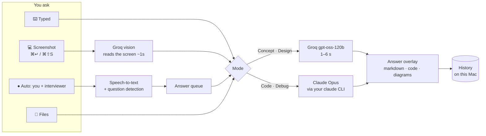

| Layer | Tech |
|:--|:--|
| App shell | **Tauri 2** (Rust) — transparent always-on-top window, hidden from screen capture, global shortcuts, system-audio capture |
| UI | **React 19 + TypeScript + Vite**, Tailwind, Radix |
| Fast answers & vision | **Groq** — `gpt-oss-120b`, Qwen vision, Whisper |
| Deep answers | **Claude Opus** through the logged-in **Claude Code CLI** |
| Storage | SQLite (Tauri plugin) — on this computer only |

More detail: [features guide](docs/features.md) · [model routing](docs/model-routing.md) · [Claude CLI provider](docs/claude-cli-provider.md) · [test workflow](docs/test-workflow.md)

---

## 🔒 Keys & privacy

- **Keys live only in `.env.local`** on your computer — it's in `.gitignore`, and `.env.example` has empty placeholders only. Never paste a key into source files, issues or screenshots.
- **Claude answers use your own Claude Code login.** Beast never reads or stores Claude tokens.
- History, transcripts and conversations are stored **on this computer only**.
- Quick check before pushing that no key slipped in:
  ```bash
  git grep -nE "gsk_[A-Za-z0-9]{10,}|sk-ant-|sk-[A-Za-z0-9]{24,}" -- . ':!*.lock' || echo "clean"
  ```

## 🩺 Troubleshooting

| Problem | Fix |
|:--|:--|
| “Screen Recording is off for Beast” | System Settings → Privacy & Security → Screen & System Audio Recording → turn on **Beast**, then quit and reopen it |
| Beast doesn't show over a full-screen app | Press ⌘\\ twice; check *Always on top* in Dashboard → Settings |
| Auto hears nothing | Check the Microphone and Screen & System Audio Recording permissions, then ⌘⇧M off and on |
| Code / Debug answers fail | Run `claude -p "hi"` — if it asks you to log in, run `claude` and log in |
| Concept / Design answers fail | Check `VITE_GROQ_API_KEY` in `.env.local`, then rebuild |

## 🧪 Testing

Browser test scripts drive the real UI through Chrome's debugging port — see `scripts/demo/`:

| Script | Checks |
|:--|:--|
| `shortcut-suite.mjs` | Every shortcut on the real screen |
| `screenshot-matrix.mjs` | 26 screenshot cases across modes and screens ([cases](docs/screenshot-test-cases.md)) |
| `continue-conversation-test.mjs` | 💻 again, follow-up with screen + file, close, History → Continue, New — 7 checks |
| `shortcuts-panel-test.mjs` | ⌨️ panel: every row ticks, Try, Quit confirm — 13 checks |
| `feature-demos.mjs` + `build-gallery.mjs` | Record the 12 demo videos and build the [demo gallery](docs/demos/index.html) |

## ❓ FAQ

<details><summary><b>Can the other side see Beast when I share my screen?</b></summary>

No. The window is marked as protected content, so macOS leaves it out of screen sharing and recordings — Zoom, Meet, Teams and QuickTime see the apps behind it. Beast also hides itself from its own screenshots.
</details>

<details><summary><b>Which API keys do I need? What does it cost?</b></summary>

One free [Groq key](https://console.groq.com/keys) for the fast answers. Code and Debug use the Claude Code CLI you are already logged into, so there is no Anthropic key and no extra bill beyond your existing Claude plan.
</details>

<details><summary><b>Does it work on Windows or Linux?</b></summary>

Beast is built and tested on macOS (system-audio capture and the overlay use macOS APIs). The browser test version runs anywhere, without global shortcuts or system audio.
</details>

<details><summary><b>Where is my data stored?</b></summary>

History, transcripts and conversations live in a local SQLite database on your Mac. Only the question itself (text, screenshot or audio) is sent to the model that answers it.
</details>

## 🗺 Roadmap

- [x] Screenshot → answer in ~2–3 s, in every mode
- [x] One Auto switch: hears you + interviewer, answers every question as a chat thread
- [x] Follow-ups with screenshots and files, History → Continue
- [x] Shortcuts panel with live ✓ tester
- [ ] Signed `.dmg` in GitHub Releases
- [ ] Windows build
- [ ] Choose any model per mode from the settings

## ⭐ Star history

<a href="https://star-history.com/#rahulsjha/BeastAI&Date">
  <picture>
    <source media="(prefers-color-scheme: dark)" srcset="https://api.star-history.com/svg?repos=rahulsjha/BeastAI&type=Date&theme=dark" />
    
  </picture>
</a>

## 🙏 Credits & licence

Beast is a fork of **[Pluely](https://pluely.com)** by Srikanth Nani, released under the **[GNU GPL v3](LICENSE)**.

<p align="center"><b>If Beast helps you land the job, give it a ⭐ — it helps others find it.</b></p>
